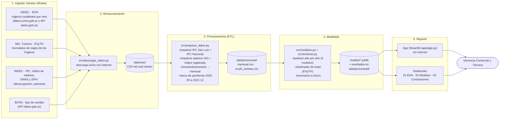
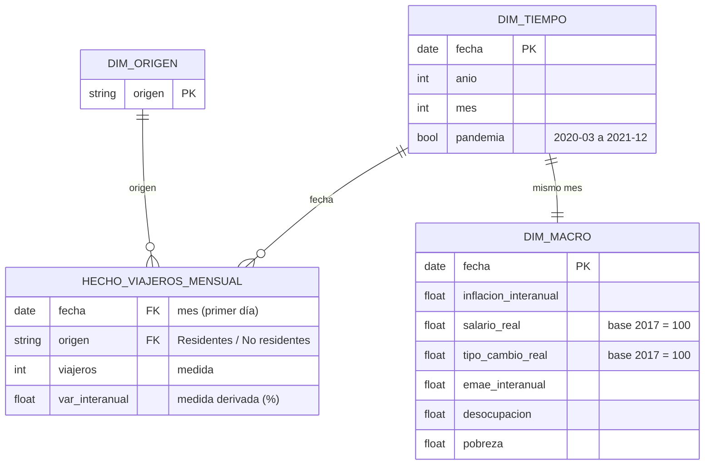
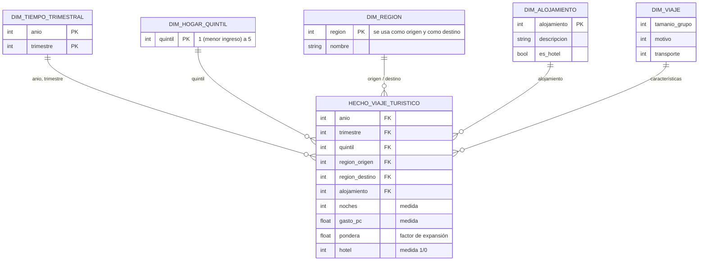

# Arquitectura de la solución

> **Aviso (25-10-2026):** la arquitectura vigente está en [`hipotesis_y_arquitectura.md`](hipotesis_y_arquitectura.md). Ese documento suma el modelo regional, los vuelos ANAC, la API FastAPI, el front web, la regla de precios y la ventana nov 2026 a oct 2027. La imagen `img/arquitectura.png` ya muestra la arquitectura nueva. La sección 1 de este archivo queda como historial de la primera versión (solo Streamlit y notebooks). La **sección 2 (modelo dimensional) sigue vigente**; le falta el data mart regional (grano: mes × región, con vuelos de cabotaje y gasto en USD).

Entregable 2 de la consigna: de dónde salen los datos, cómo se procesan y dónde terminan.

Es un proceso **batch**: las fuentes se descargan una sola vez y desde ahí todo corre sin internet. Sigue las cuatro etapas de un *data pipeline* vistas en clase (ingesta → almacenamiento → procesamiento → reporte), con una etapa de modelado entre el procesamiento y el reporte.

> Imagen para las diapositivas: `docs/img/arquitectura.png`. Se regenera con `.venv\Scripts\python docs/generar_diagrama.py docs/img/arquitectura.png`.

## 1. Tubería de datos

### Qué pasa en cada etapa

| Etapa | Qué hace | Dónde queda |
|---|---|---|
| Ingesta | Baja las series oficiales: EOH (yvera y API de Series de Tiempo de datos.gob.ar), microdatos EVyTH, IPC, salarios, EMAE, EPH y tipo de cambio. Detalle de cada URL en `data/FUENTES.md`. | `data/raw/` |
| Almacenamiento | Archivos CSV sin tocar, como copia fiel de la fuente. Permite rehacer todo sin volver a descargar. | `data/raw/` |
| Procesamiento (ETL) | Une las series por mes, empalma las que cambiaron de metodología, lleva lo trimestral y semestral a mensual, calcula salario real y tipo de cambio real (base 2017 = 100) y marca la pandemia. En EVyTH se queda solo con turistas (viajes con pernocte) y arma la variable «se alojó en hotel». | `data/processed/mensual.csv` (227 meses, 2007-01 a 2025-11) y `data/processed/evyth_turistas.csv` (242 mil viajes, 2012 a 2024-T2) |
| Modelado | Compara cinco modelos de demanda con validación temporal, reentrena el elegido (Random Forest), proyecta tres escenarios y entrena el clasificador de hotel. | `models/*.joblib`, `data/processed/backtest_*.csv`, `data/processed/proyeccion_escenarios.csv` |
| Reporte | Notebooks que cuentan la historia y una app que la gerencia puede usar sin conexión. | `notebooks/`, `app/app.py` |

### Decisiones de procesamiento documentadas

- **IPC 2007–2016:** el IPC del INDEC de esos años estuvo intervenido y no es confiable. Se usa el IPC de San Luis hasta diciembre de 2016 y se empalma con el IPC Nacional desde esa fecha.
- **Salarios:** índice de salarios de obreros industriales (ISO, trimestral) hasta 2015, empalmado con el índice de salarios registrados del INDEC desde octubre de 2015.
- **Frecuencias distintas:** desocupación (trimestral) y pobreza (semestral) se repiten en cada mes de su período.
- **Pandemia:** marzo de 2020 a diciembre de 2021 queda fuera del entrenamiento. También el año siguiente (2022), porque su comparación interanual se hace contra un mes de pandemia.
- **Pobreza:** tiene huecos de 2007 a 2016 (el INDEC no publicó). Se usa en el análisis exploratorio, no en el modelo.

## 2. Modelo dimensional (Kimball)

Los datos procesados se organizan como dos **esquemas estrella**, uno por cada proceso de negocio. En el proyecto se guardan desnormalizados (*One Big Table*), un archivo por tabla de hechos, porque el volumen es chico y así los lee directo el modelo; el diagrama muestra la estructura lógica.

### 2.1 Demanda hotelera mensual (EOH + macro)

- **Proceso de negocio:** llegada de viajeros a hoteles y parahoteles.
- **Grano declarado:** una fila por **mes × origen del viajero (residente / no residente)**. El modelo usa solo los residentes.
- **Medidas:** viajeros hospedados; variación interanual de viajeros.

### 2.2 Viajes turísticos de los hogares (EVyTH)

- **Proceso de negocio:** viaje turístico realizado por un residente.
- **Grano declarado:** una fila por **persona × viaje** (solo turistas, es decir, viajes con al menos una noche fuera).
- **Medidas:** noches, gasto per cápita, factor de expansión (`pondera`) y la marca «se alojó en hotel» (1/0).

**Por qué dos estrellas y no una:** tienen granos distintos (mes contra persona-viaje) y fuentes distintas. Mezclarlas en una sola tabla obligaría a repetir o promediar datos y se perdería precisión. Se conectan a nivel de análisis: la EOH dice **cuántos** viajeros llegan y la EVyTH dice **quiénes** eligen hotel.
