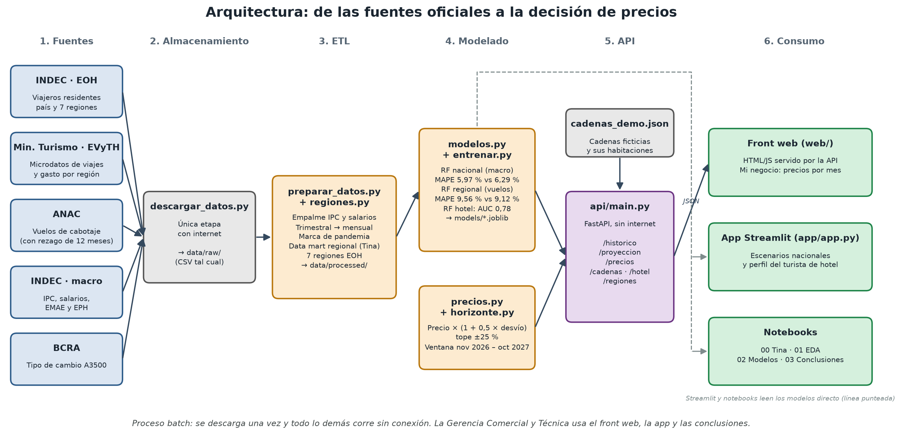
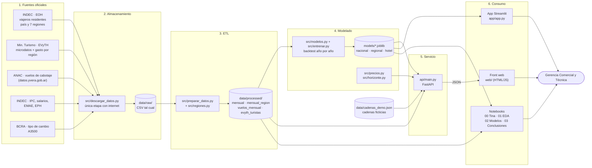
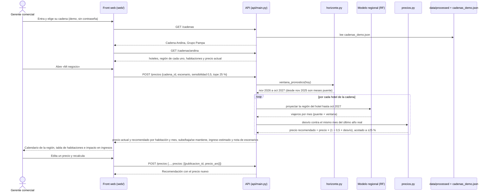

# Hipótesis y arquitectura de la solución

Estado del repo al 25-10-2026 (rama `main`). Este documento reemplaza a `docs/arquitectura.md` como referencia de arquitectura; el modelo dimensional sigue allá.

**Audiencia:** Gerencia Comercial y Técnica de una cadena hotelera argentina. No son especialistas en datos.

---

## 1. Hipótesis

### 1.1 Hipótesis original (la del arranque del TPO)

Tal como está en `SPEC.md`:

> «La demanda de turismo interno en Argentina se puede anticipar a partir del contexto económico de los hogares (salario real, inflación, desempleo, pobreza, tipo de cambio), y eso le permite a una cadena hotelera / agencia de viajes planificar la temporada de verano con números en vez de a ojo.»

### 1.2 Hipótesis actualizada — PROPUESTA (falta que el grupo la apruebe)

> **PROPUESTA:** «La demanda hotelera de turismo interno en Argentina se puede anticipar para los próximos 12 meses: en el total del país, a partir del contexto económico de los hogares, y en cada región, a partir de su temporada y de los vuelos de cabotaje. Con eso, la Gerencia Comercial y Técnica de una cadena hotelera puede planificar la temporada y ajustar el precio de cada habitación según cuánto se aparta la demanda esperada de lo normal, con números en vez de a ojo.»

| Pregunta de la cátedra | Respuesta |
|---|---|
| **¿Qué resolvemos?** | Cuántos viajeros residentes van a llegar a hoteles y parahoteles en los próximos 12 meses (nov 2026 a oct 2027), en el total del país y en cada una de las 7 regiones de la EOH, y qué precio conviene cobrar en cada mes. |
| **¿Para quién?** | Gerencia Comercial (precios, promociones, cupos) y Gerencia Técnica (personal, mantenimiento, apertura de plazas) de una cadena hotelera. |
| **¿Qué valor entrega en decisiones?** | 1) Un rango de demanda nacional según el escenario económico (optimista, base, pesimista) para dimensionar la temporada. 2) Un calendario por región que marca qué meses vienen por encima o por debajo de lo normal. 3) Un precio recomendado por habitación y por mes, con un tope para no hacer saltos bruscos. 4) Qué tipo de turista tiende a elegir hotel, para orientar las promociones. |
| **¿Qué valor entrega en plata?** | La app calcula, para cada mes, el ingreso con el precio actual y con el recomendado. En las dos cadenas de ejemplo, el precio recomendado da entre +1,9 % y +3,0 % de ingreso en los 12 meses. **Ese número supone que la ocupación no cambia cuando cambia el precio** (ocupación base de 60 % ajustada por la demanda), así que es un techo, no una promesa. Las cadenas son ficticias y los precios son de demostración. |

**Qué cambia respecto de la original:**

- Se pasa de «el verano» a una **ventana de 12 meses** (nov 2026 a oct 2027).
- Se suma la **demanda por región** y la **recomendación de precios**.
- Se saca la **pobreza**: tiene huecos de 2007 a 2016 y nunca entró al modelo.
- Se dice explícitamente qué mueve cada nivel: la macro mueve el total país y las regiones; los vuelos y la temporada, además, las regiones.

### 1.3 Qué dicen los resultados

Error promedio (MAPE) en la prueba año por año. En cada año, el modelo entrena solo con los años anteriores. Los años de prueba son 2014 a 2019 y 2023 a 2025; la pandemia queda afuera.

| Nivel | Modelo | Error del modelo | Error de «mismo mes del año anterior» | ¿Se confirma? |
|---|---|---|---|---|
| Total país | Random Forest con variables macro | **5,97 %** | 6,29 % | **Sí.** Le gana a la regla actual, sobre todo en años de crisis (2018: 3,5 % contra 5,2 %; 2019: 2,6 % contra 4,0 %; 2025: 3,8 % contra 4,8 %). Pierde en 2023, el año de PreViaje (7,9 % contra 5,7 %). |
| Por región (7 regiones) | Random Forest con vuelos de cabotaje, temporada, salario real, inflación y EMAE, con restricciones de monotonía | **9,01 %** | 9,12 % | **Apenas.** Le gana por poco a la regla actual en promedio. Gana en CABA (7,4 % contra 8,6 %) y Litoral (7,7 % contra 9,1 %), empata en Buenos Aires y Córdoba y pierde en Cuyo (10,9 % contra 9,9 %), Norte (9,1 % contra 8,6 %) y Patagonia (9,1 % contra 8,7 %). Sin macro daba 9,56 %; con las 5 macro sin restricciones, 9,35 %. |
| Quién va a hotel | Random Forest sobre la EVyTH | AUC **0,78** (árbol de decisión: 0,74), probado con viajes de 2022 en adelante | — | **Sí, para ordenar segmentos.** Su salida es una **propensión relativa**, no una probabilidad: el modelo se entrenó con clases balanceadas, así que un 60 % significa «más propenso que el turista promedio», no «6 de cada 10 van a hotel». |

**En una frase para la gerencia:** en el total del país la economía ayuda a anticipar la demanda y el modelo mejora a la regla actual. Por región, apenas: el modelo regional se equivoca un poco menos que mirar el mismo mes del año anterior (9,01 % contra 9,12 %), y los escenarios mueven cada región en el orden esperado.

**Decisiones y límites que hay que decir en la defensa:**

- **El modelo regional se mantiene por decisión del grupo** (se decidió cuando todavía no le ganaba a la regla). Aporta la ventana completa por región y la conexión con los vuelos. Hoy le gana a la regla por 0,11 puntos de error: una mejora chica.
- **Las variables macro entran al modelo regional con su signo esperado.** Con `monotonic_cst` el RF regional no puede hacer que suba la demanda cuando sube la inflación o la desocupación, ni que baje cuando suben el salario real o la actividad (el tipo de cambio queda libre). Con esa restricción, la selección de a una incorpora **salario real, inflación y EMAE** (9,01 %); desocupación, tipo de cambio real, gasto en USD y el bloque completo no bajan el error. Los escenarios económicos **mueven el total país y también las regiones** (`escenarios_afectan_region: true` en la API, calculado desde el modelo).
- **El orden de los escenarios por región es el esperado** (pesimista ≤ base ≤ optimista) en los 84 meses × región de la ventana, y hay un test que lo verifica. Sin las restricciones había 27 meses fuera de orden. El tipo de cambio real (+15 % en el pesimista) no está restringido, pero no entró al modelo regional.
- **Monotonía en el modelo nacional (propuesta, no aplicada):** con las mismas restricciones, el backtest nacional baja de 5,97 % a 5,88 % y los escenarios siguen ordenados, pero el escenario base de la ventana baja de 15,33 M a 14,96 M. Queda para que decida el grupo.
- **Hay 11 meses puente.** El último dato real de la EOH es nov 2025, y entre dic 2025 y oct 2026 la demanda también es estimada. El error de la ventana real de pronóstico es probablemente mayor que el del backtest, que predice a 1 a 12 meses de distancia.
- El modelo nacional no conoce subsidios como PreViaje. Ante programas así, su número es un piso.

---

## 2. Arquitectura

Es un proceso **batch**. Las fuentes oficiales se descargan una sola vez, y desde ahí todo corre en la computadora **sin internet**: ETL, entrenamiento, API, front web, Streamlit y notebooks. Sigue el pipeline de clase (ingesta, almacenamiento, procesamiento y reporte), con una etapa de modelado y una de servicio (API) antes del reporte.

> Imagen para las diapositivas: `docs/img/arquitectura.png`. Se regenera con `.venv\Scripts\python docs/generar_diagrama.py docs/img/arquitectura.png`.

### 2.1 Diagrama general

### 2.2 Qué hay en cada capa

**Fuentes** (detalle de URLs y rangos en `data/FUENTES.md`)

| Fuente | Organismo | Qué aporta | Hasta |
|---|---|---|---|
| EOH (país y por región de destino) | INDEC / Min. Turismo (datos.yvera.gob.ar) | Variable objetivo: viajeros residentes por mes | 2025-11 |
| EVyTH microdatos | Min. Turismo | Perfil de cada viaje (para el modelo de hotel) | 2024-T2 |
| EVyTH gasto promedio por región | Min. Turismo | Gasto por turista (pasado a USD); se probó en el modelo regional y no entró | 2024-T2 |
| Vuelos, asientos y pasajeros | ANAC (datos.yvera.gob.ar) | Conectividad aérea de cabotaje, total país | 2026-07 |
| IPC Nacional + IPC San Luis, índice de salarios + ISO, EMAE, EPH | INDEC y San Luis (API datos.gob.ar) | Contexto económico de los hogares | 2026-06 a 2026-08 |
| Tipo de cambio A3500 | BCRA | Tipo de cambio real y conversión del gasto a USD | 2026-10 |

**Almacenamiento y ETL**

| Archivo | Tecnología | Responsabilidad |
|---|---|---|
| `src/descargar_datos.py` | Python + requests | Baja cada fuente una vez. Es la única etapa que necesita internet. |
| `data/raw/` | CSV | Copia fiel de las fuentes; permite rehacer todo sin volver a descargar. |
| `src/preparar_datos.py` | pandas | Empalma el IPC (San Luis hasta 2016-12) y los salarios (ISO hasta 2015-07), pasa lo trimestral y semestral a mensual y marca la pandemia (2020-03 a 2021-12). Arma el data mart regional (EOH por región, gasto EVyTH en USD con el A3500 y vuelos ANAC de cabotaje) y limpia la EVyTH. |
| `src/regiones.py` | Python | Tabla única de las 7 regiones de la EOH (INDEC, Metodología N.º 34). La Rioja va en Cuyo y La Pampa en Patagonia. |
| `notebooks/00_tina_datamart.ipynb` | Jupyter | Trabajo original de Tina, que es la base del data mart y del modelo regional. |
| `data/processed/` | CSV | `mensual.csv` (país + macro), `mensual_region.csv` (7 regiones), `vuelos_mensual.csv`, `evyth_turistas.csv` y resultados de backtest y proyecciones. |

**Modelado y reglas de negocio**

| Archivo | Tecnología | Responsabilidad |
|---|---|---|
| `src/modelos.py` | scikit-learn | Tres modelos: (1) **nacional**, un RF que predice la variación interanual de viajeros con mes, salario real, inflación, desocupación, tipo de cambio real y actividad; (2) **regional**, un RF con región, temporada y variación de vuelos, asientos y pasajeros de cabotaje con 12 meses de rezago; (3) **hotel**, un RF clasificador sobre la EVyTH con `class_weight="balanced"`. En los dos de demanda, viajeros = mismo mes del año anterior × (1 + variación). |
| `src/entrenar.py` | Python | Corre los backtests, la selección de variables regional, reentrena y guarda los `.joblib` y las proyecciones. |
| `models/*.joblib` | joblib | `demanda_rf`, `demanda_region_rf`, `hotel_rf` y `hotel_arbol`. |
| `src/horizonte.py` | pandas | Ventana de pronóstico: los 12 meses que siguen a hoy (nov 2026 a oct 2027). Cada mes se marca como real, puente, pronóstico o tendencia. |
| `src/precios.py` | numpy | Regla de precios: desvío = demanda proyectada de la región / mismo mes del último año real − 1; **precio recomendado = precio × (1 + 0,5 × desvío)**, con el ajuste acotado a **±25 %**. También calcula la ocupación esperada y el ingreso por mes. |
| `data/cadenas_demo.json` | JSON | Dos cadenas ficticias (Cadena Andina y Grupo Pampa) con hoteles, regiones, habitaciones y precios de ejemplo. |

**Servicio y consumo**

| Archivo | Tecnología | Responsabilidad |
|---|---|---|
| `api/main.py` | FastAPI + uvicorn | Lee `data/processed/` y `models/` una sola vez y expone `GET /regiones`, `GET /historico`, `POST /proyeccion`, `POST /hotel`, `GET /cadenas`, `GET /cadenas/{id}` y `POST /precios`. Sin región usa el modelo nacional; con región, el regional. |
| `web/` | HTML + JS | Front para la gerencia: entrar como cadena, panel con mapa por región, «Mi negocio» con precios, supuestos económicos y perfil del turista. Consume la API y lo sirve la misma API. Lo está construyendo otro agente; el diseño de referencia es el prototipo de Claude Design (https://claude.ai/artifact/Q5SzerUABzML1Zj8AnQHcT, pantallas en `docs/diseno/README.md`). |
| `app/app.py` | Streamlit + plotly | App anterior, que sigue vigente: escenarios nacionales, controles para mover la macro y perfil de hotel. Lee los modelos directo, sin pasar por la API. |
| `notebooks/01` a `03` | Jupyter | EDA, comparación de modelos y conclusiones con storytelling. |
| `tests/` | pytest | Preparación de datos, modelos, horizonte, precios y API. |

### 2.3 Consulta típica: la cadena entra y pide precios

Las proyecciones regionales quedan en caché dentro de la API (`functools.cache`), así que la segunda consulta de la misma región responde al instante.

### 2.4 Decisiones clave y por qué

| Decisión | Por qué |
|---|---|
| **Batch y sin internet** (solo la descarga inicial la necesita) | La consigna exige que la defensa funcione sin depender de la red del aula. Además, las fuentes publican datos mensuales o trimestrales, así que no hace falta tiempo real. |
| **CSV y joblib, sin base de datos** | Son pocos datos (unos 230 meses por serie y 242 mil viajes). Una base agregaría instalación y servicios sin ganar nada. El modelo dimensional se guarda desnormalizado (OBT), como se explica en `docs/arquitectura.md`. |
| **Predecir la variación interanual y no el nivel** | La regla «mismo mes del año anterior» ya captura la temporada. Al modelo se le pide solo lo que esa regla no sabe. Además, un Random Forest no extrapola fuera del rango histórico, y la variación sí queda dentro de ese rango. |
| **Validación año por año**, sin mezclar el futuro en el entrenamiento | Simula cómo se habría usado el modelo en el pasado. Es la única forma honesta de comparar contra la regla actual. |
| **Pandemia fuera del entrenamiento** (2020-03 a 2021-12, y 2022 como objetivo interanual) | La demanda dependió de las restricciones y no de la economía. |
| **Dos modelos de demanda separados** (nacional con macro; regional con región, temporada, vuelos y macro) | El regional necesita la región y los vuelos. De la macro entran salario real, inflación y EMAE, con restricciones de monotonía para que respeten el signo esperado: bajan su error (9,56 % → 9,01 %) y ordenan los escenarios en todas las regiones. |
| **Modelo regional mantenido** aunque su ventaja sobre la regla sea chica (9,01 % contra 9,12 %) | Decisión del grupo: da la ventana completa por región y usa vuelos de cabotaje que ya están publicados hasta jul 2026. Se informa el resultado sin maquillar. |
| **Vuelos con 12 meses de rezago y sin supuesto en los escenarios** | Con 12 meses de rezago, casi toda la ventana usa vuelos ya observados (hasta jul 2027 inclusive). Los escenarios dejan los vuelos sin cambio porque, con pocos años útiles (2019, 2024 y 2025), el modelo aprendió un signo al revés por el shock de 2024. Lo que mueve los escenarios regionales es la macro. |
| **7 regiones de la EOH verificadas con INDEC** (La Rioja en Cuyo) | Es la definición de la variable objetivo. La EVyTH pone La Rioja en Norte: se corrige en los microdatos, pero no en la serie de gasto, que ya viene agregada. |
| **Precio con sensibilidad 0,5 y tope de ±25 %, contra el mismo mes del último año real, calculado sobre el precio publicado** | Es una regla simple y explicable: la mitad del desvío de demanda pasa al precio, y el tope evita saltos que espanten clientes. El promedio de 3 años incluye 2023 (PreViaje), que fue un año alto, y predecía peor. Comparar con el mismo mes del año anterior estimado (`anio_anterior`) no mejora a la distancia de la ventana (12,45 % contra 12,38 %). El recomendado se calcula siempre sobre el precio publicado (o un `precio_base`), así aplicar la recomendación no la encadena. Sensibilidad, tope y referencia se pueden cambiar en la API. |
| **Hotel: propensión relativa, no probabilidad** | Con `class_weight="balanced"`, el modelo infla la clase «hotel». Sirve para ordenar perfiles de más a menos propensos, no para decir qué porcentaje va a hotel. |
| **API FastAPI + front HTML/JS servido por la misma API** | Hay un solo proceso que levantar en la defensa. El front no hace cálculos: toda la lógica queda en `src/`, testeada, y la usan igual la API, Streamlit y los notebooks. |
| **Streamlit se mantiene** | Ya está probada sin internet y sirve como plan B de la demo si el front web no llega. |

---

## 3. Pendientes y contradicciones encontradas

Están en archivos que no se tocaron acá, porque otros agentes trabajan en ellos.

1. **Hipótesis desalineada en cuatro lugares.** `SPEC.md` incluye pobreza, `README.md` incluye actividad y no pobreza, y `docs/presentacion.md` usa una versión corta sin regiones ni precios. Cuando el grupo apruebe la propuesta de la sección 1.2, hay que unificarla en `SPEC.md`, `README.md` y `docs/presentacion.md`.
2. **`POST /hotel` devuelve el campo `probabilidad`**, y `docs/diseno/README.md` dice «Probabilidad de alojarse en hotel». Es una propensión relativa. La docstring de la API y Streamlit ya lo dicen bien; falta renombrar el campo o la etiqueta del front.
3. **`api/main.py` todavía no sirve `web/`** (no hay `StaticFiles` ni carpeta `web/` en el repo hoy). Depende del agente del front.
4. **`README.md` y `SPEC.md` no mencionan la API, el front web, el modelo regional ni la ventana de 12 meses.** El README sigue hablando del verano 2027 (3,06 millones en el escenario base) y de la app Streamlit como única aplicación. La tabla de entregables de `SPEC.md` apunta a `docs/arquitectura.md` y a `app/app.py`.
5. **`docs/presentacion.md` no tiene diapositivas del modelo regional ni de precios,** ni la frase honesta «el regional le gana a la regla solo por poco (9,01 % contra 9,12 %)». La diapositiva 4 describe cuatro fuentes, y ahora son cinco (falta ANAC).
6. **Resuelto (25-10-2026). Matiz de la selección de variables regional.** De a una, las macro subían el error y el bloque de las 5 lo bajaba a 9,35 %, pero desordenaba los escenarios (optimista por debajo del base en 27 meses × región). **Se resolvió con restricciones de monotonía** (`monotonic_cst`): con ellas, la selección de a una incorpora salario real, inflación y EMAE, el error baja a **9,01 %** (por debajo de la regla, 9,12 %) y los escenarios quedan ordenados en todas las regiones.
7. **El ingreso estimado de `/precios` no tiene en cuenta la reacción de la demanda al precio** (ocupación fija de 60 % × desvío), así que subir precios siempre da más ingreso. Hay que decirlo en la demo o sumar un supuesto de elasticidad.
8. **Resuelto (25-10-2026). Sesgo al alza de la recomendación.** El desvío compara un mes de la ventana (por ejemplo, ene 2027) contra el mismo mes del último año real (ene 2025), con dos años de variación en el medio. Se probó la referencia `anio_anterior` (el mismo mes 12 meses antes, real o puente): en el backtest a 2 años no mejora (12,45 % contra 12,38 %), así que **`ultimo_anio` sigue por defecto** y `anio_anterior` queda como opción en `POST /precios`. Con el modelo monótono, en las cadenas de ejemplo (252 publicaciones × mes, escenario base) quedan **152 «sube», 0 «baja» y 100 «se mantiene»** (con `anio_anterior`: 29, 0 y 223). Además, el recomendado ahora se calcula sobre el precio publicado: aplicar la recomendación ya no la encadena (85.000 → 87.100 → 89.300). El front tiene que aclarar que el desvío es contra el último año real.
9. **Notebooks `02_modelos` y `03_conclusiones` con cambios sin commitear.** Antes de la defensa, hay que verificar que sus números coincidan con los de este documento (5,97 % / 6,29 %, 9,01 % / 9,12 %, AUC 0,78).
